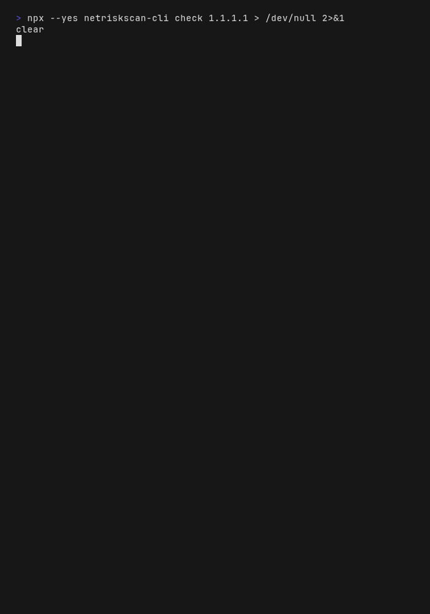

# NetRiskScan CLI

**IP intelligence for products, infrastructure, and security automation.**

`netriskscan-cli` is the official command-line interface and typed TypeScript client for the [NetRiskScan Developer API](https://www.netriskscan.com/developers). It helps engineering teams inspect IP addresses, enrich network context, evaluate reputation signals, and bring IP intelligence into existing applications and automated workflows.

Use the CLI for investigations and operational tasks. Use the TypeScript client or Developer API to integrate the same server-side assessment into your own product.

[](https://github.com/TeamQQ/netriskscan-cli/actions/workflows/ci.yml)
[](https://www.npmjs.com/package/netriskscan-cli)
[](https://www.netriskscan.com)
[](LICENSE)

<p align="center">
  <a href="https://www.netriskscan.com/developers"><strong>Developer API &amp; plans</strong></a>
  &nbsp;·&nbsp;
  <a href="https://www.npmjs.com/package/netriskscan-cli">npm package</a>
  &nbsp;·&nbsp;
  <a href="https://www.netriskscan.com/methodology.html">Scoring methodology</a>
  &nbsp;·&nbsp;
  <a href="https://github.com/TeamQQ/netriskscan-cli/issues">Support</a>
</p>

<p align="center">
  
</p>

## Product overview

NetRiskScan turns an IP address into structured network intelligence through one Developer API. The CLI is the fastest way to evaluate the service from a terminal; the bundled TypeScript client provides a direct integration path for Node.js applications.

The CLI does not calculate a separate score or invent classifications locally. Risk assessment, signal evaluation, and enrichment are performed by the NetRiskScan API. The client presents the server response in human-readable or machine-readable form.

**Important score semantics:** the NetRiskScan Index is a cleanliness-oriented score. A higher Index means a cleaner address; it is not a threat score.

## Use cases

NetRiskScan can provide IP intelligence as an input to existing product and security workflows:

- **Account and transaction risk workflows** — enrich signup, login, checkout, and account-review events with proxy, VPN, Tor, datacenter, scanner, and abuse signals.
- **Traffic classification** — distinguish network and anonymity characteristics when evaluating incoming connections.
- **Infrastructure validation** — review VPS, hosting, and IP-pool reputation before deployment, migration, or provider changes.
- **Security operations** — add network attribution and server-returned risk reasons to incident triage, support investigations, and log analysis.
- **Automation and CI/CD** — screen IP lists, consume JSON/JSONL output, and apply explicit policy gates with stable exit codes.

NetRiskScan provides diagnostic network intelligence, not a complete fraud engine or an automatic verdict. Combine its signals with your own application context and decision policies.

## Intelligence returned

The Developer API provides a normalized assessment and supporting network context:

| Data | What it provides |
| --- | --- |
| **NetRiskScan Index & band** | A normalized IP cleanliness assessment. Higher is cleaner. |
| **Independent signals** | Proxy, VPN, Tor, datacenter, scanner, and abuse flags. Each signal preserves `true`, `false`, or `null` (unknown). |
| **Network attribution** | Network type, profile, service, ASN, organization, operator domain, and containing CIDR range when resolved. |
| **IP geolocation** | Network-level country, region, city, continent, postal code, approximate coordinates, and time zone when available. |
| **Verified identity** | Known search-crawler identity, such as Googlebot, Bingbot, or Applebot, when verified by the API. |
| **Risk reasons** | Server-generated reason codes with category and severity. Reasons can describe positive infrastructure evidence as well as risk signals. |

Fields are returned only when the API can resolve them. Unknown or unavailable values are not silently converted into negative signals.

## Quick start

Run a real IP lookup without installing the package globally:

```bash
npx netriskscan-cli check 1.1.1.1
```

The command uses the anonymous evaluation allowance when no API key is configured. For sustained usage, account-level quota, and production integrations, configure a Developer API key.

## Installation

Requires **Node.js 20 or later**.

Run on demand with `npx`:

```bash
npx netriskscan-cli check 1.1.1.1
```

Or install globally:

```bash
npm install -g netriskscan-cli
netriskscan check 1.1.1.1
```

The installed executable is `netriskscan`; the npm package name is `netriskscan-cli`.

## Access model

Choose the access mode that matches the workload:

| Access mode | Best for | How it works |
| --- | --- | --- |
| **Anonymous evaluation** | First lookups and quick CLI tests | `check` and `batch` can run without an API key. Requests are metered by the caller's public IP and subject to a daily allowance. |
| **Developer API key** | Application integration and account-level usage | Key-authenticated requests use the Developer Account's plan quota. The `usage` command requires a key. |
| **Paid plan** | Sustained production traffic and higher-volume workloads | Select a plan based on required quota, request rate, and concurrency. Current limits and pricing are shown in the Developer Dashboard. |

A Developer account includes a Free Plan for evaluation. For production workloads, use a plan that matches your expected traffic and operational requirements. Plan allowances, rate limits, and concurrency can change; the Developer Dashboard is the source of truth.

[Explore Developer API access and plans](https://www.netriskscan.com/developers).

## Anonymous trial

The `check` and `batch` commands can be used without credentials. When no API key is configured, the CLI sends **no** `Authorization` header and the Developer API serves the request through an anonymous daily trial, metered by the caller's public IP.

The current default allowance is **30 requests per public IP per UTC day**. The allowance reported by the API response is authoritative; the CLI does not maintain a local counter or estimate remaining requests.

Use an API key when you need account-level quota, sustained usage, or billing-period usage reporting. Anonymous trial exhaustion returns `429 anonymous_daily_limit_reached`; this deterministic response is not automatically retried.

| Command | API key |
| --- | --- |
| `netriskscan check` | Optional — anonymous trial is used when omitted |
| `netriskscan batch` | Optional — anonymous trial is used when omitted |
| `netriskscan usage` | Required — retrieves Developer Account plan and billing-period usage |

A configured but invalid or disabled key is never silently downgraded to anonymous access.

## Getting an API key

Use a Developer API key for application integration, account-level quota, and usage reporting:

1. Create a [NetRiskScan Developer account](https://www.netriskscan.com/developers) and open the Developer Dashboard.
2. Go to **API Keys** and create a key with the scopes required by your integration:
   - `ip-risk:read` — IP risk and network intelligence lookups.
   - `usage:read` — account usage reporting.
3. Copy the full key when it is created. It is shown in full only once.

Set the key as an environment variable instead of putting it directly in a command, source file, or shell history:

```bash
export NETRISKSCAN_API_KEY="nrs_live_xxx"
```

Then run authenticated lookups and inspect account usage:

```bash
netriskscan check 1.1.1.1 --verbose
netriskscan usage
```

Current plan quotas, billing-period allowances, request-rate limits, concurrency limits, and pricing are maintained in the Developer Dashboard rather than hard-coded in this README.

## CLI and TypeScript integration

Use the command-line interface for manual checks, operational scripts, batch screening, and CI/CD. For Node.js or TypeScript applications, the same npm package exports `NetRiskScanClient` and typed response/error definitions.

Install it as an application dependency:

```bash
npm install netriskscan-cli
```

Minimal integration:

```ts
import { NetRiskScanClient } from "netriskscan-cli";

const client = new NetRiskScanClient({
  apiKey: process.env.NETRISKSCAN_API_KEY,
});

const { data } = await client.checkIp("1.1.1.1");

console.log("NetRiskScan Index:", data.risk.index);
console.log("Proxy:", data.flags.proxy);
console.log("VPN:", data.flags.vpn);
console.log("Network:", data.network.organization);
```

The SDK preserves the API's response semantics, including nullable signals and optional enrichment fields. It does not reproduce the scoring model locally.

## Table of contents

- [Product overview](#product-overview)
- [Use cases](#use-cases)
- [Intelligence returned](#intelligence-returned)
- [Quick start](#quick-start)
- [Installation](#installation)
- [Access model](#access-model)
- [Anonymous trial](#anonymous-trial)
- [Getting an API key](#getting-an-api-key)
- [CLI and TypeScript integration](#cli-and-typescript-integration)
- [IP risk check](#ip-risk-check)
- [Usage & quota](#usage--quota)
- [Batch processing](#batch-processing)
- [JSON output](#json-output)
- [JSONL output](#jsonl-output)
- [CI/CD](#cicd)
- [Environment variables](#environment-variables)
- [Exit codes](#exit-codes)
- [API errors](#api-errors)
- [Rate limits & quota](#rate-limits--quota)
- [SDK usage](#sdk-usage)
- [Security](#security)
- [Developer API](#developer-api)
- [FAQ](#faq)
- [Official resources](#official-resources)
- [Contributing](#contributing)
- [License](#license)

## IP risk check

```bash
netriskscan check <ip> [options]
```

Calls `GET /v1/ip-risk/{ip}` - no query string parameters are ever sent. An API key is
optional; without one the request uses the [anonymous trial](#anonymous-trial).

Supports **IP Intelligence Schema 1.6.0**: `network.domain` / `network.range` and the
extended `location` fields (continent, postal code, approximate coordinates). The
upgrade is purely additive - a server that predates these fields still works unchanged,
and `--json` / `--jsonl` pass every field through verbatim.

```bash
$ netriskscan check 1.1.1.1

NetRiskScan

IP                1.1.1.1
Index             92
Band              excellent
Assessment        complete

Risk Reasons
Public Infrastructure         info

Network
Type              public_infrastructure
Connection        direct
ASN               AS13335
Organization      Cloudflare, Inc.
Domain            cloudflare.com
Network Range     1.1.1.0/24

Location
Country           United States (US)
Continent         North America (NA)
Time Zone         America/Los_Angeles

Signals
Proxy             No
Proxy Type        -
VPN               No
Tor               No
Datacenter        Unknown
Scanner           No
Abuse             No

Identity
Search Crawler    No
Crawler           -

Request ID        req_xxxxxxxx
```

Output above is illustrative of the format - actual values always come from the live
API response.

### Proxy, VPN and Tor Signals

`netriskscan check` doubles as a proxy detection CLI, VPN detection CLI and Tor
detection CLI in one command: the `Signals` block reports `Proxy`, `VPN`, `Tor`,
`Datacenter`, `Scanner` and `Abuse` as independent three-state flags
(`true` / `false` / `unknown`), so it also works as a datacenter IP checker without
collapsing an unresolved signal into a false negative.

### Proxy Type

`Proxy Type` is a classification detail for an address already detected as a proxy - it
refines `Proxy`, it does not replace it. It renders as `-`, not `Unknown`, whenever the
address is not a proxy at all:

```text
Signals
Proxy             Yes
Proxy Type        Residential Proxy
```

The server-reported machine value (`residential_proxy`, `isp_proxy`, `mobile_proxy`,
`datacenter_proxy`, `unknown_proxy`) is what `--json`/`--jsonl` carry; the CLI only maps
it to a human-readable label (`Residential Proxy`, `ISP Proxy`, ...) in the default
terminal output.

### Search Crawler

The `Identity` block shows whether the NetRiskScan API has verified this address as a
known search engine crawler, and if so, its canonical name (`Googlebot`, `Bingbot`,
`Applebot`, ...) exactly as the server sends it - the CLI never reformats, cases, or
enumerates crawler names locally. **The CLI does not perform crawler verification
itself; it only displays the classification the API already returned.** A verified
crawler is identity information, not a risk signal, so it never affects `risk.index`,
`--fail-on`, or the CLI's exit code.

### Network Domain and Range

Schema 1.6.0 adds two network-attribution rows, shown only when the server resolved
them:

```text
Network
Type              public_infrastructure
Connection        direct
ASN               AS15169
Organization      Google LLC
Domain            google.com
Network Range     8.8.8.0/24
```

- `Domain` is the **operating organisation's trusted primary domain** (e.g.
  `google.com`, `cloudflare.com`) - the operator itself, not a website hosted on the
  address and not a cloud customer's domain. The CLI never infers it from the ASN,
  organization or reverse DNS; it prints only what the server sent.
- `Network Range` is the **canonical CIDR prefix containing the queried address** (IPv4
  or IPv6, e.g. `8.8.8.0/24` or `2001:4860:4840::/42`). It is the server's answer, shown
  verbatim - the CLI never computes, widens or guesses a range itself.

Both fields are optional and nullable: `null`, an empty value, or a server that predates
Schema 1.6.0 simply prints no row. Neither field affects `risk.index` or any exit code.

### Risk Reasons

`risk.reasons` is the server's own explanation of the assessment it just returned - the
CLI renders it and **never derives, infers, or invents a reason** from the flags it can
see. `flags.tor: true` is not enough to claim `TOR_EXIT_NODE`; only the server can say
whether an address is an exit node or an ordinary relay, and the CLI prints whichever it
actually sent.

```text
Risk Reasons
Residential Proxy Detected    high
```

Reasons are **not proof of fraud or malicious activity**. `VPN_DETECTED` means a VPN was
detected, nothing more. Nor are they all negative: `VERIFIED_SEARCH_CRAWLER`,
`PUBLIC_INFRASTRUCTURE` and `RESIDENTIAL_NETWORK` are exactly the reasons an address
scores _well_, which is why the block is called `Risk Reasons` and not "threats".

```text
Risk Reasons
Verified Search Crawler       info
Public Infrastructure         info
```

Each reason carries a `code`, a `category` and a `severity`. The default output shows a
readable label (`Residential Proxy Detected`) and the severity; `--json` / `--jsonl`
always carry the raw machine values (`RESIDENTIAL_PROXY_DETECTED`, `anonymity`, `high`).
The vocabulary is **additive** - the API can introduce new codes at any time, and an
already-installed CLI renders an unfamiliar one rather than failing or hiding it.

Reasons are display-only: they never affect `risk.index`, `--fail-below`, `--fail-on`, or
the exit code. A server that predates the field simply omits it, and the section is not
shown when there is nothing to explain.

### Location

`location` is **network-level IP geolocation**: where the address is registered and
routed. As an IP geolocation CLI, `netriskscan check` reports this network-level data
only - it is **not** device or GPS location, and not the precise physical location of
whoever is using the address - a city can be the operator's aggregation point rather than
the user's town.

```text
Location
Country           United States (US)
Region            Illinois (IL)
City              Chicago
Continent         North America (NA)
Postal Code       60666
Coordinates       41.8781, -87.6298
Time Zone         America/Chicago
```

Every field is independently optional. Geo resolution is often partial, and the CLI shows
only what the server actually resolved rather than padding the block with placeholders -
a country-only result prints one row, and an address with no location at all prints no
`Location` section at all:

```text
Location
Country           Germany (DE)
Time Zone         Europe/Berlin
```

Schema 1.6.0 extends the block with three more rows, each shown only when the server
resolved it:

- `Continent` - the UN geoscheme continent name and code, formatted exactly like
  `Country` and `Region` (`North America (NA)`).
- `Postal Code` - the data source's postal code, printed verbatim as a string. Leading
  zeros survive; it is never reformatted or parsed into a number.
- `Coordinates` - `latitude, longitude`, shown only when the server sent **both** as
  numbers. This is an **approximate network location**, not a device GPS fix, and a
  legitimate `0` coordinate is preserved (`0, 0` renders as `0, 0`).

Anycast networks (public DNS resolvers, some CDN edges), unlocatable addresses and
private/reserved addresses may return `null` for coordinates and postal code - an
anycast address has no single node position. The CLI then prints no row rather than a
fabricated value, and never completes, guesses or computes geography client-side.

Names and codes are server-owned strings, printed verbatim: never translated,
re-capitalized, or derived from one another. `location` has no effect on the risk
assessment or on any exit code.

### Addresses that can't be scored

Private, loopback, reserved, and other non-routable addresses still return `HTTP 200`,
but with `risk.assessmentGrade: "insufficient"` and `risk.index` / `risk.band` set to
`null`. The CLI shows this as:

```text
Index             N/A
Band              N/A
Assessment        insufficient

This address could not be reliably assessed.
```

This is a normal, successful response - the CLI's default exit code stays `0` unless
you opt into CI policy checks with `--fail-below` (see [CI/CD](#cicd)).

### Options

| Option                 | Description                                                                                     |
| ---------------------- | ----------------------------------------------------------------------------------------------- |
| `--api-key <key>`      | API key for this call, optional (overrides `NETRISKSCAN_API_KEY`; anonymous trial when omitted) |
| `--base-url <url>`     | Override the API base URL (advanced)                                                            |
| `--json`               | Machine-readable JSON output (see [JSON output](#json-output))                                  |
| `--verbose`            | Also print rate limit, quota, and request id                                                    |
| `--debug`              | Print a stack trace / extra detail on failure                                                   |
| `--timeout <ms>`       | Request timeout in milliseconds (default `10000`)                                               |
| `--max-retries <n>`    | Max automatic retries for `429`/`503` (default `3`)                                             |
| `--fail-below <index>` | CI gate: exit non-zero if `risk.index` is below this threshold                                  |
| `--fail-on <flag>`     | CI gate: exit non-zero if the given flag is `true` (repeatable)                                 |

## Usage & quota

```bash
netriskscan usage
```

Calls `GET /v1/usage`. **This command requires an API key** (with the `usage:read`
scope): it reports Developer Account plan, billing period and quota, which has no
anonymous equivalent. Without a key it fails immediately, without sending a request:

```text
Error: An API key is required for the usage command.

Set NETRISKSCAN_API_KEY or use --api-key.
```

```bash
$ netriskscan usage

NetRiskScan Usage

Plan                 growth

Usage
Used                 12,450
Remaining            37,550
Limit                50,000

Rate limit
Requests / minute    120

Billing period
2026-08-01 → 2026-09-01
```

Supports `--json`, `--verbose`, `--api-key`, `--timeout`, and `--max-retries` just like
`check`.

## Batch processing

```bash
netriskscan batch <file> [options]
```

Use `netriskscan batch` as a batch IP lookup CLI or bulk IP reputation checker: point
it at a file of one IP per line and get a risk result for every address, with
concurrency control and JSONL output for pipelines.

**Important:** NetRiskScan does not currently expose a server-side batch endpoint. This
command is a **client-side batch**: it sends individual `GET /v1/ip-risk/{ip}` requests
with a controlled concurrency limit. An API key is optional here too - without one, every
request draws on the [anonymous trial](#anonymous-trial), and the summary reports what the
server says is left. It never calls `/v1/ip-risk/batch` or
`/v1/ip-risk/query` - those endpoints are not open and currently return
`404 feature_not_available`.

Input is one IP per line; blank lines and lines starting with `#` are ignored:

```text
# ips.txt
1.1.1.1
8.8.8.8
9.9.9.9
2606:4700:4700::1111
```

```bash
netriskscan batch ips.txt
cat ips.txt | netriskscan batch -
netriskscan batch ips.txt --concurrency 10 --jsonl > results.jsonl
```

### Concurrency

```bash
netriskscan batch ips.txt --concurrency 5   # default
netriskscan batch ips.txt --concurrency 10
```

Concurrency defaults to a conservative `5` and is capped at `20` regardless of what you
pass - it is never unbounded. Make sure the concurrency you choose complies with the
limits shown in your NetRiskScan Developer Dashboard for your plan.

A failure on one IP never drops the others - every input line gets a result.

Run anonymously and the human summary ends with the trial position:

```text
4 succeeded, 0 failed

Anonymous trial
Available         19
Daily Limit       30
```

`Available` is the **lowest** `usage.remaining` seen in the batch, because concurrent
responses do not arrive in the order the server charged them. If any request came back
`anonymous_daily_limit_reached`, it reports `0`. The CLI never rejects an input file for
being longer than the daily allowance: it cannot know how much of today's allowance you
have already spent - only the server can. `--jsonl` output is unaffected; each line's
`result.usage` object already carries this, and no plain text is ever mixed into the
stream.

### Options

| Option              | Description                                                                                    |
| ------------------- | ---------------------------------------------------------------------------------------------- |
| `--api-key <key>`   | API key for this run, optional (overrides `NETRISKSCAN_API_KEY`; anonymous trial when omitted) |
| `--base-url <url>`  | Override the API base URL (advanced)                                                           |
| `--concurrency <n>` | Concurrent requests (default `5`, max `20`)                                                    |
| `--jsonl`           | Newline-delimited JSON output (see [JSONL output](#jsonl-output))                              |
| `--timeout <ms>`    | Per-request timeout in milliseconds (default `10000`)                                          |
| `--max-retries <n>` | Max automatic retries per request for `429`/`503` (default `3`)                                |

## JSON output

Add `--json` to turn `check` into a JSON IP lookup CLI for scripts and pipelines:

```bash
netriskscan check 1.1.1.1 --json
```

Prints exactly the API response body as JSON, with `null` preserved as `null` (never
coerced to `false`, `0`, or a string):

```json
{
  "requestId": "req_example",
  "risk": {
    "index": 95,
    "band": "excellent",
    "assessmentGrade": "complete",
    "reasons": [{ "code": "VERIFIED_SEARCH_CRAWLER", "category": "identity", "severity": "info" }]
  },
  "network": {
    "type": "public_infrastructure",
    "profile": "search_crawler",
    "service": "Googlebot",
    "connectionType": "direct",
    "asn": "AS15169",
    "organization": "Google LLC",
    "domain": "google.com",
    "range": "66.249.66.0/24"
  },
  "location": {
    "countryCode": "US",
    "country": "United States",
    "regionCode": "CA",
    "region": "California",
    "city": "Mountain View",
    "timeZone": "America/Los_Angeles",
    "continentCode": "NA",
    "continent": "North America",
    "postalCode": "94043",
    "latitude": 37.422,
    "longitude": -122.084
  },
  "flags": {
    "proxy": false,
    "proxyType": null,
    "vpn": false,
    "tor": false,
    "datacenter": false,
    "scanner": null,
    "abuse": false,
    "searchCrawler": true,
    "searchCrawlerName": "Googlebot"
  }
}
```

`risk.reasons`, `location`, `flags.proxyType` (when `flags.proxy` is `true`),
`flags.searchCrawler`, and `flags.searchCrawlerName` carry the server's raw machine values
in `--json`/`--jsonl` - e.g. `"RESIDENTIAL_PROXY_DETECTED"` and `"residential_proxy"`,
never the `Residential Proxy Detected` / `Residential Proxy` labels shown in the default
terminal output. A server that predates these fields simply omits the keys; the CLI does
not synthesize them.

The Schema 1.6.0 fields (`network.domain`, `network.range`, `location.continentCode`,
`location.continent`, `location.postalCode`, `location.latitude`, `location.longitude`)
pass through the same way: `null` stays `null` (never `0`, `false` or `""`), a legitimate
`0` coordinate stays `0`, and `postalCode` stays a string.

In `--json` mode there is no spinner, no ANSI color, and no banner - stdout carries only
the JSON. Errors always go to stderr, so this composes cleanly:

```bash
netriskscan check 1.1.1.1 --json | jq '.risk.index'
```

## JSONL output

```bash
netriskscan batch ips.txt --jsonl
```

One JSON object per line, one line per input IP:

```json
{"ip":"1.1.1.1","ok":true,"result":{"requestId":"req_...","risk":{...,"reasons":[...]},"network":{...},"location":{...},"flags":{...}}}
{"ip":"8.8.8.8","ok":true,"result":{...}}
{"ip":"bad-ip","ok":false,"error":{"code":"invalid_ip","message":"..."}}
```

Designed for `netriskscan batch ips.txt --jsonl > results.jsonl` and downstream
line-oriented processing (`jq`, `grep`, log pipelines, etc.). A failed IP never causes
the whole batch to fail or drops output for the rest.

The envelope (`ip`, `ok`, `result` / `error`) belongs to the CLI; everything under
`result` is the API response verbatim, so `location`, `risk.reasons` and the Schema 1.6.0
network/geo fields (`domain`, `range`, continent, postal code, coordinates) appear there
untouched. The default batch table deliberately stays narrow - it grows no country, city,
domain, range or reason columns - so use `--jsonl` when you need the full record.

## CI/CD

`--fail-below` and `--fail-on` turn `check` into an IP reputation CI check: use it
with policy flags as a build/deploy gate:

```bash
netriskscan check "$TARGET_IP" --fail-below 60
netriskscan check "$TARGET_IP" --fail-on tor --fail-on proxy
```

Rules:

- `risk.index >= threshold` → exit `0`
- `risk.index < threshold` → exit `6` (CI policy failed)
- `risk.index == null` (address could not be assessed) → exit `7`, a distinct code from
  a normal policy failure
- `--fail-on <flag>` only trips on an explicit `true`. A `null` (unknown) value is never
  treated as a hit - that would silently turn "we don't know" into "blocked".

## Environment variables

| Variable               | Description                                                                                              |
| ---------------------- | -------------------------------------------------------------------------------------------------------- |
| `NETRISKSCAN_API_KEY`  | Default API key, used when `--api-key` is not passed. Optional for `check`/`batch`; required for `usage` |
| `NETRISKSCAN_BASE_URL` | Advanced: override the API base URL, used when `--base-url` is not passed                                |

## Exit codes

| Code | Meaning                                                             |
| ---- | ------------------------------------------------------------------- |
| `0`  | Success                                                             |
| `1`  | General CLI error                                                   |
| `2`  | Invalid CLI argument                                                |
| `3`  | Authentication / authorization failure                              |
| `4`  | API request failure                                                 |
| `5`  | Rate limit / quota exceeded, including the anonymous daily trial    |
| `6`  | CI policy failed (`--fail-below` / `--fail-on`)                     |
| `7`  | Assessment unavailable (`--fail-below` used against a `null` index) |

These codes are stable and part of the CLI's public contract.

## API errors

The API returns a consistent error shape:

```json
{
  "error": {
    "code": "quota_exceeded",
    "message": "Billing period quota exhausted.",
    "requestId": "req_8f3ab21c9d"
  }
}
```

The CLI prints this as:

```text
NetRiskScan API error

Code       quota_exceeded
Status     429
Message    Billing period quota exhausted.
Request ID req_8f3ab21c9d
```

Known error codes:

| HTTP status | `error.code`                    | Meaning                                                                                               |
| ----------- | ------------------------------- | ----------------------------------------------------------------------------------------------------- |
| 400         | `invalid_ip`                    | The address is not a valid IPv4/IPv6 address                                                          |
| 400         | `invalid_request`               | Unsupported query parameter, or request too large                                                     |
| 400         | `unsupported_parameter`         | e.g. `forceRefresh` / `force_refresh` / `refresh` - not supported                                     |
| 401         | `invalid_api_key`               | Missing/malformed `Authorization` header, or key doesn't exist                                        |
| 403         | `api_key_disabled`              | Key revoked/expired, or account/plan unavailable                                                      |
| 403         | `scope_not_allowed`             | Key lacks the scope required for this endpoint                                                        |
| 404         | `not_found`                     | Unknown path                                                                                          |
| 404         | `feature_not_available`         | Endpoint not yet available (e.g. batch, see above)                                                    |
| 429         | `rate_limit_exceeded`           | Per-minute request limit exceeded                                                                     |
| 429         | `quota_exceeded`                | Billing-period quota exhausted                                                                        |
| 429         | `anonymous_daily_limit_reached` | Anonymous daily trial exhausted. Never retried automatically - it cannot succeed before the UTC reset |
| 503         | `temporarily_unavailable`       | Transient upstream/service issue - retry later                                                        |

Transient `429 rate_limit_exceeded` and `503` responses may be retried automatically,
honoring `Retry-After` when present and falling back to exponential backoff with jitter
otherwise. `anonymous_daily_limit_reached` is **never** retried, even though it is also a
`429`: the daily allowance cannot come back before the UTC reset, so retrying would only
repeat the same failure three more times. `400` / `401` / `403` / `404` are never retried
either.

Pass `--debug` to any command to include a stack trace on failure. Without it, errors
are shown as a clean summary - never a raw stack dump.

## Rate limits & quota

The anonymous daily trial and a plan's billing-period quota are different things, reported
through different channels. Do not read one as the other.

### Anonymous daily trial

Reported in the response body, on every request:

| Field              | Meaning                                                          |
| ------------------ | ---------------------------------------------------------------- |
| `usage.mode`       | `anonymous` when the request was served by the trial             |
| `usage.remaining`  | Requests still available today - authoritative, never recomputed |
| `usage.dailyLimit` | The trial's daily allowance                                      |
| `usage.resetAt`    | When the allowance resets (UTC day boundary)                     |

### API key quota

Every successful `/v1/*` response carries live rate limit and quota headers, so you
don't need a separate call to `/v1/usage` to know where you stand:

| Header                                                              | Meaning                                             |
| ------------------------------------------------------------------- | --------------------------------------------------- |
| `X-RateLimit-Limit` / `X-RateLimit-Remaining` / `X-RateLimit-Reset` | Per-minute limit                                    |
| `X-Quota-Limit` / `X-Quota-Used` / `X-Quota-Remaining`              | Billing-period quota                                |
| `X-Request-Id`                                                      | Request trace id (echoes yours, or a generated one) |
| `Retry-After`                                                       | Present on `429` responses                          |

See them with:

```bash
netriskscan check 1.1.1.1 --verbose
```

```text
Rate limit    118 / 120 remaining
Quota         37,550 / 50,000 remaining
Request ID    req_xxxxxxxx
```

## SDK usage

The package also exports `NetRiskScanClient` and its response and error types for direct
Node.js/TypeScript integration. The CLI and SDK use the same API client and response contract:

The client needs no configuration at all. Without an API key it sends no `Authorization`
header and uses the anonymous trial:

```ts
import { NetRiskScanClient } from "netriskscan-cli";

const client = new NetRiskScanClient();

const { data } = await client.checkIp("1.1.1.1");
console.log(data.risk.index);

if (data.usage?.mode === "anonymous") {
  console.log("available:", data.usage.remaining);
}
```

Pass `apiKey` to use Developer Account quota instead. `getUsage()` is account data and
always requires a key - without one it throws `NetRiskScanConfigError` before any request
is made:

```ts
import { NetRiskScanClient, NetRiskScanApiError } from "netriskscan-cli";

const client = new NetRiskScanClient({
  apiKey: process.env.NETRISKSCAN_API_KEY,
  timeout: 10000,
  maxRetries: 3,
});

try {
  const { data, meta } = await client.checkIp("1.1.1.1");
  console.log(data.risk.index, data.risk.band, data.flags.vpn);
  console.log(meta.rateLimit.remaining, meta.quota.remaining);
} catch (err) {
  if (err instanceof NetRiskScanApiError) {
    console.error(`${err.code}: ${err.message} (requestId=${err.requestId})`);
  } else {
    throw err;
  }
}
```

```ts
const usage = await client.getUsage();
console.log(usage.data.units.remaining);
```

The response types are exported too, including `IpLocation` and `RiskReason`:

```ts
import type { IpRiskResponse, IpLocation, RiskReason } from "netriskscan-cli";

const { data } = await client.checkIp("66.249.87.5");

for (const reason of data.risk.reasons ?? []) {
  console.log(reason.code, reason.severity);
}
console.log(data.location?.country ?? "unknown");
console.log(data.network.domain ?? "unknown");
console.log(data.network.range ?? "unknown");

// Coordinates are a pair: both numbers or both null (anycast). 0 is a real coordinate.
const { latitude, longitude } = data.location ?? {};
if (typeof latitude === "number" && typeof longitude === "number") {
  console.log("approximate network position:", latitude, longitude);
}
```

Both are optional on `IpRiskResponse`, and every field inside `IpLocation` is nullable: an
older server omits them entirely, and a newer one can resolve a country without a city.
`RiskReason.code` / `category` / `severity` are plain `string`s on purpose, so a reason
code added server-side after your build still type-checks and still renders.

Schema 1.6.0 adds `network.domain` / `network.range` and `IpLocation.continentCode` /
`continent` / `postalCode` / `latitude` / `longitude`. All seven are optional and nullable
(`field?: T | null`): an older server omits them, a newer one can send `null`, and the
coordinate pair is either both numbers or both `null` (an anycast network has no single
node position). `postalCode` is a string, and `0` coordinates are legitimate values - read
them with a type check, never a truthiness check.

See [examples/](examples/) for runnable scripts.

## Security

- The CLI never prints, logs, or includes a full API key in error output or telemetry.
- There is no telemetry: **the CLI does not collect usage analytics or telemetry** of any
  kind, in any version.
- If `--debug` needs to show an authorization value, it is redacted
  (`Bearer nrs_live_abcd****1234`) - never printed in full.
- Prefer `export NETRISKSCAN_API_KEY=...` over passing `--api-key` inline, to keep the
  key out of shell history and process listings where practical.
- See [SECURITY.md](SECURITY.md) for how to report vulnerabilities and what to do if a
  key leaks.

## Developer API

|                 |                                                                  |
| --------------- | ---------------------------------------------------------------- |
| Base URL        | `https://api.netriskscan.com`                                    |
| Current version | `v1` (path prefix `/v1`, **not** `/api/v1`)                      |
| Response schema | IP Intelligence Schema 1.6.0 (additive; older servers supported) |

This is a completely separate system from the netriskscan.com website's internal
`/api/public/*` endpoints - different auth, different response shapes, no compatibility
guarantees between the two. `netriskscan-cli` only ever calls `/v1/*`.

Currently available endpoints:

- `GET /v1/ip-risk/{ip}`
  - anonymous access supported
  - API key optional
  - API key requests use account quota and require `ip-risk:read`
- `GET /v1/usage` - requires an API key with `usage:read`

There is currently **no** server-side batch, history, or key-management endpoint
(`POST /v1/ip-risk/batch`, `POST /v1/ip-risk/query`, `GET /v1/history`,
`GET|POST /v1/key`, etc. are not implemented). API key creation/rotation/revocation is
only available through the Developer Dashboard.

`/v1/*` never accepts query string parameters - all inputs are path parameters.

See the official [Methodology](https://www.netriskscan.com/methodology.html) page for
how the NetRiskScan Index itself is computed (this project does not - and will not -
reimplement that logic client-side).

## FAQ

### How do I look up an IP address from the command line?

Run `netriskscan check <ip>` - no account or API key required for the anonymous daily
trial. See [Quick start](#quick-start).

### How do I check IP reputation from a terminal?

`netriskscan check <ip>` prints the NetRiskScan Index, band, network and signal data
for that address. See [IP risk check](#ip-risk-check).

### How do I check an IP risk score using the CLI?

The `Index` and `Band` fields in `netriskscan check` output are the risk score;
`--fail-below <index>` turns that score into a CI/CD gate. See [CI/CD](#cicd).

### How do I detect proxy, VPN or Tor IPs from the command line?

`netriskscan check <ip>` reports `Proxy`, `VPN` and `Tor` as independent signals in
the `Signals` block, plus a `Proxy Type` classification when a proxy is detected. See
[Proxy, VPN and Tor Signals](#proxy-vpn-and-tor-signals).

### Can the CLI detect Tor exit nodes?

It reports the `Tor` signal and, when the API includes a Tor-exit-specific risk
reason, prints it under `Risk Reasons` - the CLI only relays what the server
verifies, it never infers exit-node status locally. See [Risk Reasons](#risk-reasons).

### How do I check multiple IP addresses in bulk?

`netriskscan batch ips.txt` reads one IP per line and runs a client-side batch against
the Developer API with controlled concurrency. See [Batch processing](#batch-processing).

### Can I get IP lookup results as JSON?

Yes - `netriskscan check <ip> --json` prints the raw API response, and
`netriskscan batch ips.txt --jsonl` prints one JSON object per line. See
[JSON output](#json-output) and [JSONL output](#jsonl-output).

### Does NetRiskScan CLI work without an API key?

Yes. `check` and `batch` run on an anonymous daily trial with no signup and no API
key. `usage` always requires a key. See [Anonymous trial](#anonymous-trial).

## Official resources

- [NetRiskScan](https://www.netriskscan.com) - web-based IP reputation and network
  intelligence
- [NetRiskScan methodology](https://www.netriskscan.com/methodology.html) - how the
  NetRiskScan Index and assessment model work
- [netriskscan-cli on npm](https://www.npmjs.com/package/netriskscan-cli)
- [GitHub repository](https://github.com/TeamQQ/netriskscan-cli)

## Contributing

See [CONTRIBUTING.md](CONTRIBUTING.md).

## License

[MIT](LICENSE)
